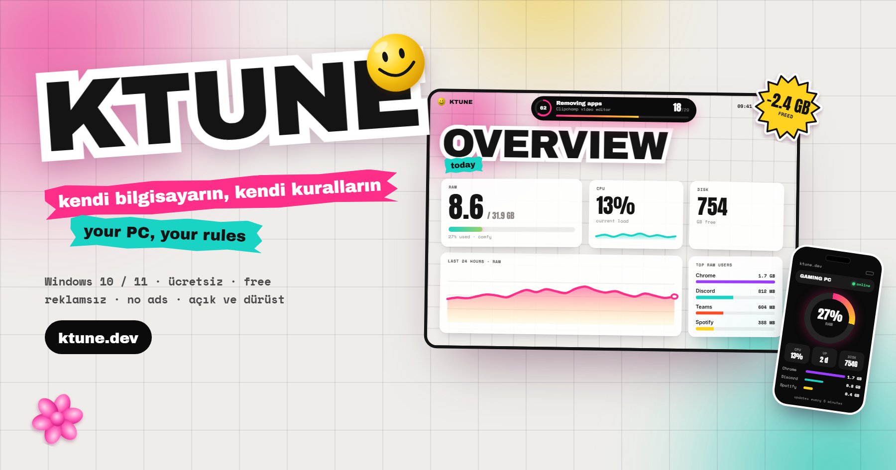

<p align="center">
  <a href="https://ktune.dev"></a>
</p>

<p align="center">
  <a href="https://github.com/kutaykayikci/ktune-releases/releases/latest"></a>
  
  
</p>

<p align="center"><b>Türkçe</b> · <a href="#english">English</a></p>

## Türkçe

<p align="center">
  <a href="https://github.com/kutaykayikci/ktune-releases/releases/latest/download/KTUNE-Setup.exe"></a>
</p>

**Windows için ücretsiz, reklamsız bakım aracı.** Açılışta habersiz başlayanları susturur, RAM'i kimin yediğini gösterir, Windows'la gelen gereksiz uygulamaları kaldırır, reklamı ve Copilot'u kapatır. Yaptığı her değişiklik tek tıkla geri alınır.

| Sekme | Ne yapar |
|---|---|
| **ÖZET** | RAM, işlemci, disk, son 24 saat grafiği, en çok yiyenler ve uyarılar |
| **PC** | İşlemci, ekran kartı, RAM yuvaları, disk sağlığı, bağlı cihazlar |
| **AÇILIŞ** | Bilgisayar açılırken habersiz başlayan her şey tek listede; silmez, susturur |
| **RAM** | Süreçler ada göre gruplu (Chrome'un 14 parçası tek satır), 7 günlük geçmiş, şişenler |
| **UYGULAMA** | Clipchamp, Xbox, Solitaire… İş uygulamaları ayrı, Store ve sistem bileşenleri kilitli |
| **AYAR** | Reklam kimliği, Başlat önerileri, Bing araması, Copilot, Recall, telemetri |
| **TEMİZLİK** | Önbellek, geçici dosyalar, çökme dökümleri, Windows Update artıkları |

### Kurulum
1. **[KTUNE-Setup.exe](https://github.com/kutaykayikci/ktune-releases/releases/latest/download/KTUNE-Setup.exe)**'yi indir (kısa adres: [ktune.dev/indir](https://ktune.dev/indir)).
2. Çalıştır. Yönetici izni istemez; kendi kullanıcı klasörüne kurulur, Python ya da başka bir şey gerekmez.
3. **"Windows bilgisayarınızı korudu"** uyarısı çıkarsa: KTUNE henüz kod imzalama sertifikasıyla imzalı değil. **Ek bilgi → Yine de çalıştır** demen yeterli.

### Güncellemeler
KTUNE kendini günceller. Yeni sürüm çıkınca pencerenin sağ üstünde **GÜNCELLE** belirir; tek tıkla iner, SHA-256'sı doğrulanır ve sessizce kurulur. Neyin değiştiği her sürümün notunda: **[sürüm notları](https://github.com/kutaykayikci/ktune-releases/releases)**.

<details>
<summary><b>İndirdiğin dosyayı doğrulamak (isteğe bağlı)</b></summary>

PowerShell'de:

```powershell
Get-FileHash "$env:USERPROFILE\Downloads\KTUNE-Setup.exe" -Algorithm SHA256
```

Çıkan değer, sürüm notundaki **SHA-256** ile aynı olmalı.
</details>

### Hesap ve telefon (isteğe bağlı)
KTUNE hesapsız da tam çalışır. Ücretsiz hesap açarsan bilgisayarlarının canlı durumunu (RAM, CPU, açık kalma süresi, en çok yiyenler), 30 günlük geçmişini ve yaptığın işlemleri **[ktune.dev/panel](https://ktune.dev/panel/)**'den telefonundan bile takip edersin. Nasıl göründüğüne [örnek panelden](https://ktune.dev/demo) bakabilirsin. Neyin gidip neyin asla gitmediği: **[gizlilik](https://ktune.dev/gizlilik/)**.

### Kaldırma
**Ayarlar → Uygulamalar → Yüklü uygulamalar → KTUNE → Kaldır.** Kaldırırken bilgisayarındaki yerel verileri (ölçümler, geçmiş) de silmek isteyip istemediğin sorulur.

---

## English

<p align="center">
  <a href="https://github.com/kutaykayikci/ktune-releases/releases/latest/download/KTUNE-Setup.exe"></a>
</p>

**A free, ad-free tune-up tool for Windows.** It mutes what sneaks into startup, shows who's eating your RAM, removes the junk Windows ships with, and turns off ads and Copilot. Every change can be undone in one click. The app speaks Turkish and English.

| Tab | What it does |
|---|---|
| **OVERVIEW** | RAM, CPU, disk, a 24-hour chart, top RAM users and alerts |
| **PC** | CPU, GPU, RAM slots, disk health, connected devices |
| **STARTUP** | Everything that starts with Windows, in one list; it mutes, never deletes |
| **RAM** | Processes grouped by name (Chrome's 14 processes on one line), 7-day history, leaks |
| **APPS** | Clipchamp, Xbox, Solitaire… Work apps kept separate, Store and system parts locked |
| **TWEAKS** | Advertising ID, Start suggestions, Bing search, Copilot, Recall, telemetry |
| **CLEANUP** | Caches, temp files, crash dumps, Windows Update leftovers |

### Install
1. Download **[KTUNE-Setup.exe](https://github.com/kutaykayikci/ktune-releases/releases/latest/download/KTUNE-Setup.exe)** (short link: [ktune.dev/indir](https://ktune.dev/indir)).
2. Run it. No admin rights needed; it installs into your user folder, no Python or anything else required.
3. If you see **"Windows protected your PC"**: KTUNE isn't code-signed yet. Click **More info → Run anyway**.

### Updates
KTUNE updates itself. When a new version is out, **UPDATE** appears at the top right of the window; one click downloads it, verifies its SHA-256 and installs it quietly. What changed is in each version's notes: **[release notes](https://github.com/kutaykayikci/ktune-releases/releases)**.

<details>
<summary><b>Verify the file you downloaded (optional)</b></summary>

In PowerShell:

```powershell
Get-FileHash "$env:USERPROFILE\Downloads\KTUNE-Setup.exe" -Algorithm SHA256
```

The result should match the **SHA-256** in the release notes.
</details>

### Account and phone (optional)
KTUNE works fully without an account. With a free one, you can follow your PCs' live status (RAM, CPU, uptime, top apps), their 30-day history and what you did, at **[ktune.dev/panel](https://ktune.dev/panel/)**, even from your phone. See [a sample dashboard](https://ktune.dev/demo). What goes to the cloud and what never does: **[privacy](https://ktune.dev/gizlilik/?lang=en)**.

### Uninstall
**Settings → Apps → Installed apps → KTUNE → Uninstall.** You'll be asked whether to also delete the local data on your PC (measurements, history).

---

<p align="center"><sub>Bu repo yalnızca kurulum dosyalarını ve sürüm notlarını barındırır; her sürüm GitHub Actions'ta derlenip test edilir ve derleme kaydı Actions sekmesinde görülebilir.<br>This repo only hosts installers and release notes; every version is built and tested on GitHub Actions, and its build log is visible in the Actions tab.</sub></p>

<p align="center"><a href="https://ktune.dev">ktune.dev</a> · <a href="mailto:kutaykayikci3@gmail.com">kutaykayikci3@gmail.com</a> · <a href="https://buymeacoffee.com/kutaykayikci">☕ Buy me a coffee</a></p>
